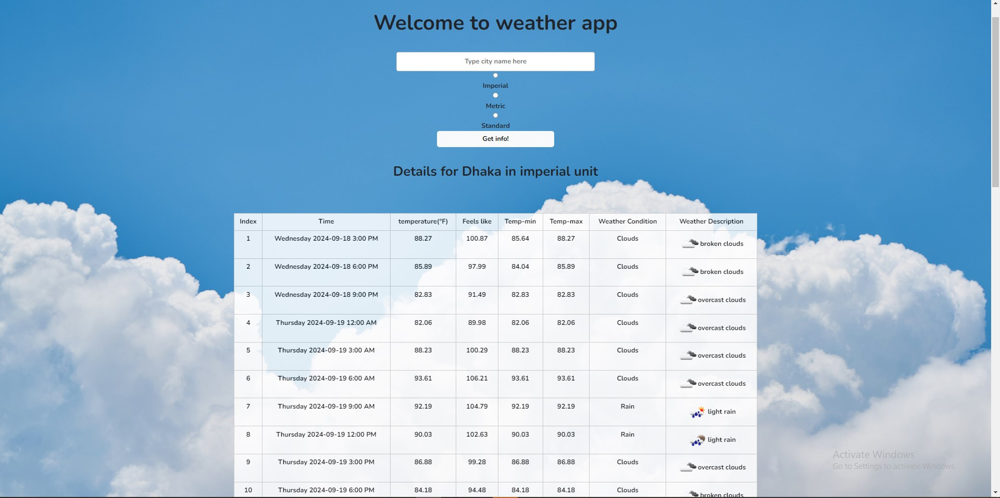
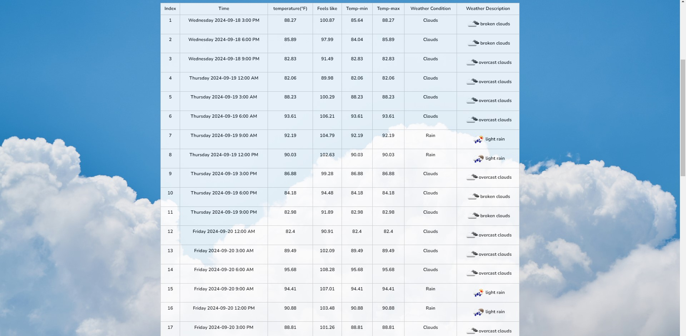

# Live Weather Web App

A PHP weather app that shows the 5-day forecast for any city in 3-hour steps. Users enter a city, choose a unit system (Metric, Imperial, or Standard), and see a table with temperature, feels-like, min and max values, and the weather condition with an icon.

## Screenshots





## Features

- 5-day forecast in 3-hour intervals (40 entries)
- Unit selection: Metric (°C), Imperial (°F), or Standard (K)
- Weather icons and descriptions from OpenWeatherMap
- Responsive layout for PC, laptop, tablet, and mobile
- Friendly error message when a city isn't found

## Tech Stack

- PHP
- CSS (`indexStyle.css`)
- Bootstrap 5.3
- OpenWeatherMap Forecast API
- Google Fonts (Nunito)

## Getting Started

### Prerequisites

- PHP 8.0 or later
- A free API key from [OpenWeatherMap](https://openweathermap.org/api)

### 1. Clone the repository

```bash
git clone https://github.com/SM-Aqib-Hossain/Live-Weather-Web-APP.git
cd Live-Weather-Web-APP
```

### 2. Set your API key

The app reads the key from an environment variable, so it never needs to be stored in the code.

Linux or macOS:

```bash
export OPENWEATHER_API_KEY="your_api_key_here"
```

Windows PowerShell:

```powershell
$env:OPENWEATHER_API_KEY = "your_api_key_here"
```

### 3. Run the app

```bash
php -S localhost:8000
```

Open `http://localhost:8000` in your browser.

## Project Structure

```
Live-Weather-Web-APP/
├── index.php        Main page, form handling, and API request
├── indexStyle.css   Styles
├── bg.jpg           Background image
└── README.md
```

## Notes

- Free OpenWeatherMap keys have rate limits. If you see the "unavailable" message often, wait a few minutes or check your usage on the dashboard.
- Never commit your API key to the repository.

## Author

**SM Aqib Hossain**
- GitHub: [@SM-Aqib-Hossain](https://github.com/SM-Aqib-Hossain)
- LinkedIn: [sm-aqib-hossain](https://www.linkedin.com/in/sm-aqib-hossain-b3a97b228/)
